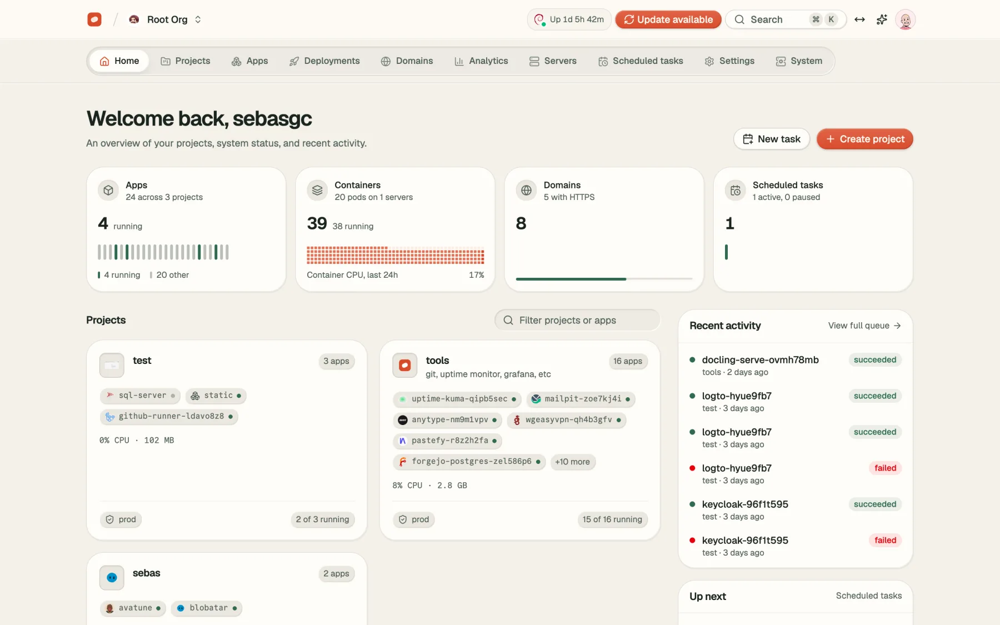
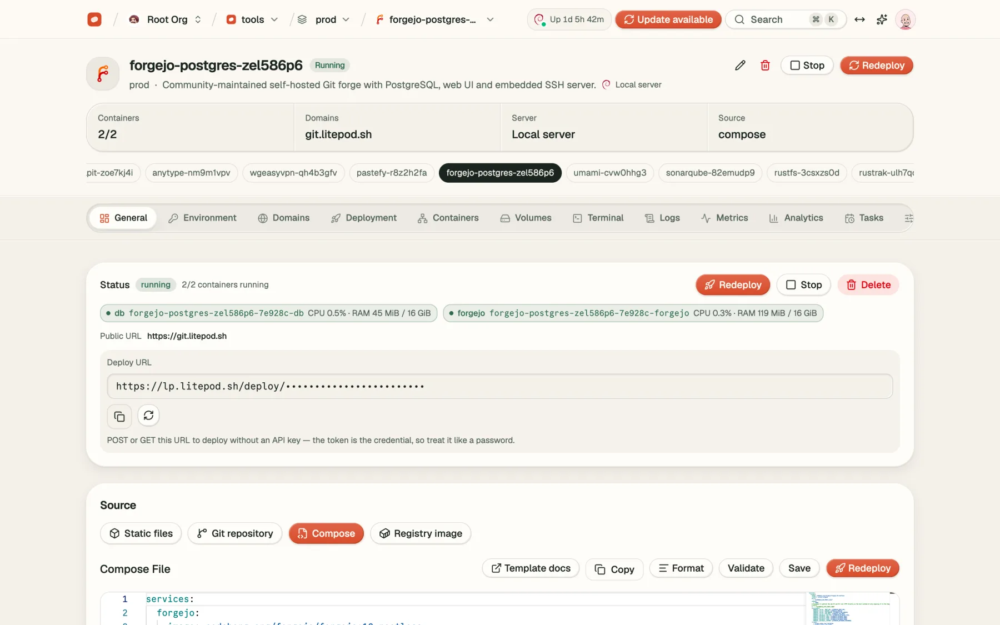
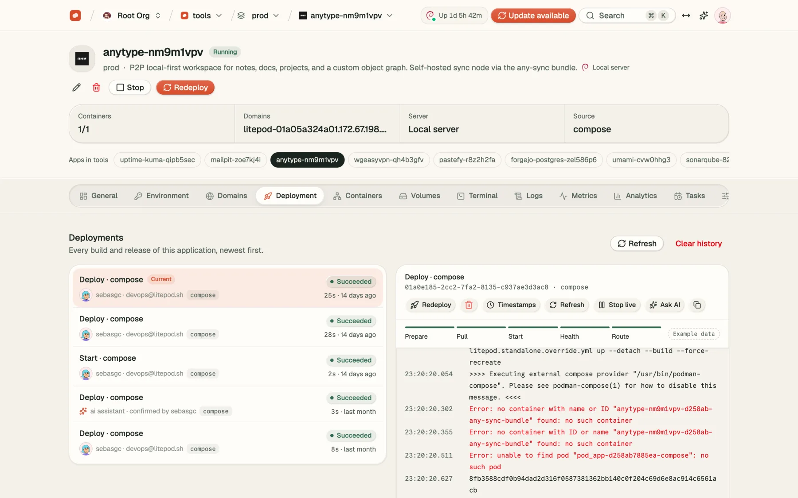
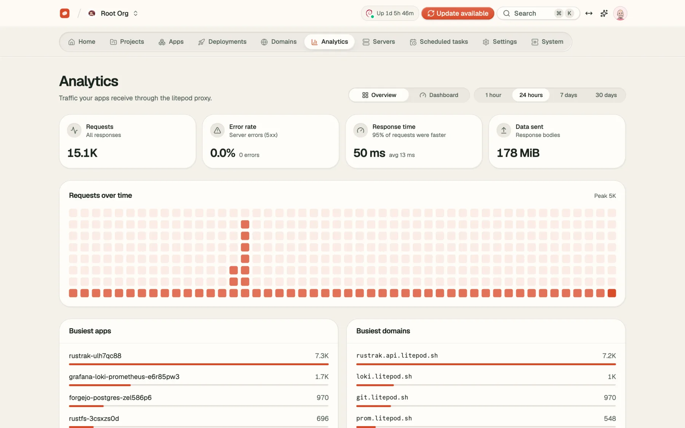
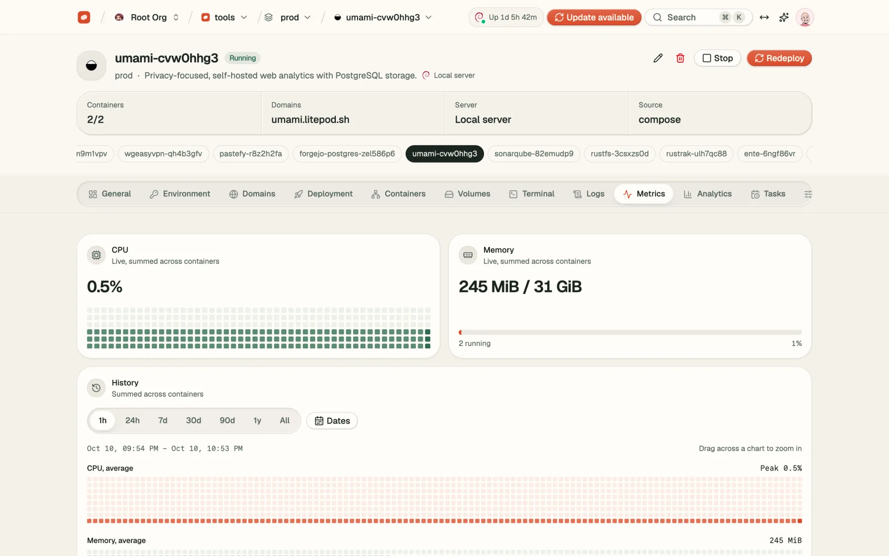
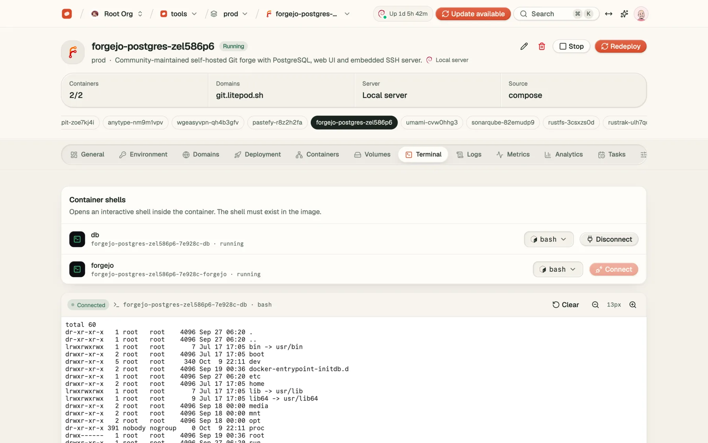
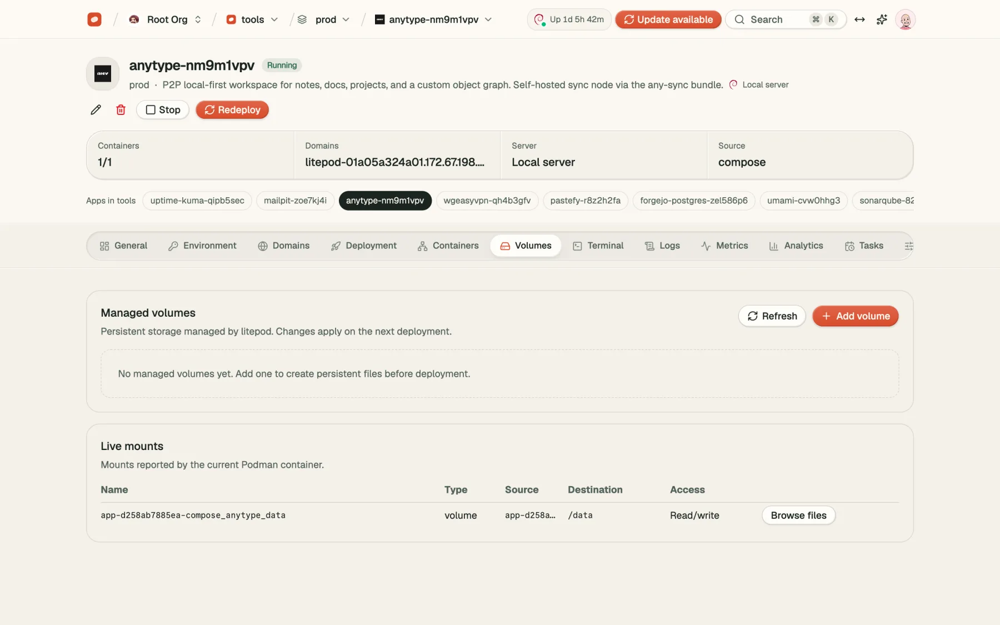
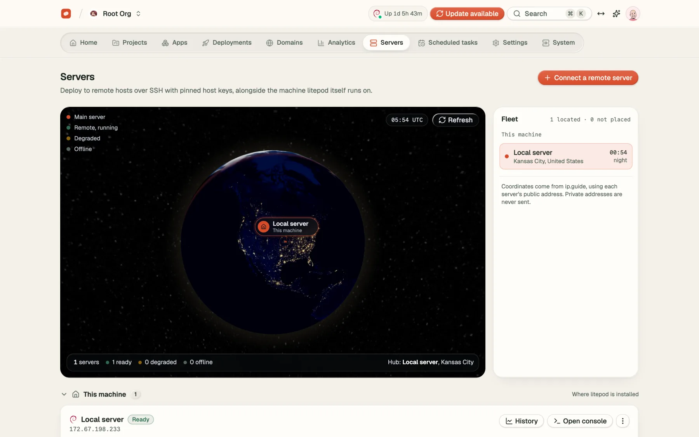
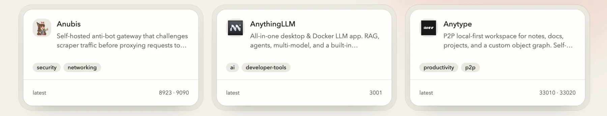

<div align="center">

<a href="https://litepod.sh">
  
</a>

# Litepod

**Aloja tus apps. Mantén el control.**

Litepod es un PaaS open source y autoalojable construido sobre Podman — una alternativa ligera a Heroku, Vercel y Netlify.
Despliega aplicaciones, bases de datos y servicios en servidores que son tuyos, con un panel claro en lugar de una caja negra.

[Sitio web](https://litepod.sh) · [Documentación](https://docs.litepod.sh) · [Demo en vivo](https://demo.litepod.sh) · [Plantillas](https://templates.litepod.sh) · [Litepod Cloud](https://app.litepod.sh/register?utm_source=github&utm_medium=readme&utm_campaign=cloud) · [Roadmap](ROADMAP.md)

[English](README.md) · **Español**

<picture>
  <source media="(prefers-color-scheme: dark)" srcset="assets/screenshots/home-dark.webp">
  
</picture>

</div>

## Por qué Litepod

La mayoría de los PaaS autoalojados son una capa fina sobre Docker o una plataforma pesada que necesita su propio servidor solo para funcionar. Litepod está en el medio:

- **Podman, no Docker.** Sin daemon y rootless por defecto. Ningún socket privilegiado expuesto a internet.
- **Huella mínima.** Una instalación nueva usa cerca de **63 MB de RAM** en tres contenedores (medido con `podman stats`).
- **Rust + SvelteKit.** Una API en axum sobre SQLite y un panel rápido en Svelte 5. El control plane no necesita Postgres ni Redis.
- **Tu máquina, tus datos.** Todo corre en infraestructura que controlas. Sin lock-in: exporta, migra o autoaloja cuando quieras.

## Funcionalidades

- **Despliegues desde Git** — haz push y despliega desde GitHub, con los logs del build en vivo. Construye con Railpack (sin configuración), un `Dockerfile` o Compose.
- **Compose nativo** — despliega stacks de varios contenedores desde un `compose.yml` como una sola aplicación.
- **Plantillas en un clic** — empieza desde un stack conocido, define las variables y publica. Explóralas en [templates.litepod.sh](https://templates.litepod.sh).
- **Bases de datos** — crea bases de datos junto a tus apps, con volúmenes persistentes.
- **HTTPS automático** — dominios propios con certificados TLS emitidos y renovados por Caddy.
- **Flota de servidores** — conecta servidores Debian, Ubuntu, Fedora o Arch por SSH solo con llave. Usa un edge público, un relay privado o mantén los servicios privados.
- **Observabilidad** — analíticas de peticiones, errores y latencia a través del proxy, más CPU y memoria por aplicación. Las analíticas y métricas se guardan en una base [DuckDB](https://duckdb.org) embebida _(beta)_.
- **Terminal web** — abre una shell dentro de cualquier contenedor desde el navegador.
- **Volúmenes** — inspecciona y edita almacenamiento persistente y montajes en vivo.
- **Backups** — copias programadas a cualquier bucket compatible con S3.
- **Equipos** — organizaciones, miembros y roles.

## Capturas

<table>
  <tr>
    <td width="50%">
      <picture>
        <source media="(prefers-color-scheme: dark)" srcset="assets/screenshots/overview-dark.webp">
        
      </picture>
      <p align="center"><b>Resumen</b> — estado, URL de despliegue y compose en una vista</p>
    </td>
    <td width="50%">
      <picture>
        <source media="(prefers-color-scheme: dark)" srcset="assets/screenshots/deployments-dark.webp">
        
      </picture>
      <p align="center"><b>Despliegues</b> — cada build con su log en vivo</p>
    </td>
  </tr>
  <tr>
    <td width="50%">
      <picture>
        <source media="(prefers-color-scheme: dark)" srcset="assets/screenshots/analytics-dark.webp">
        
      </picture>
      <p align="center"><b>Analíticas</b> — peticiones, errores y latencia a través del proxy</p>
    </td>
    <td width="50%">
      <picture>
        <source media="(prefers-color-scheme: dark)" srcset="assets/screenshots/metrics-dark.webp">
        
      </picture>
      <p align="center"><b>Métricas</b> — CPU y memoria por aplicación</p>
    </td>
  </tr>
  <tr>
    <td width="50%">
      <picture>
        <source media="(prefers-color-scheme: dark)" srcset="assets/screenshots/terminal-dark.webp">
        
      </picture>
      <p align="center"><b>Terminal</b> — una shell dentro de cualquier contenedor</p>
    </td>
    <td width="50%">
      <picture>
        <source media="(prefers-color-scheme: dark)" srcset="assets/screenshots/volumes-dark.webp">
        
      </picture>
      <p align="center"><b>Volúmenes</b> — almacenamiento persistente y montajes en vivo</p>
    </td>
  </tr>
  <tr>
    <td width="50%">
      <picture>
        <source media="(prefers-color-scheme: dark)" srcset="assets/screenshots/fleet-dark.webp">
        
      </picture>
      <p align="center"><b>Flota</b> — todos tus servidores en un globo</p>
    </td>
    <td width="50%">
      <picture>
        <source media="(prefers-color-scheme: dark)" srcset="assets/screenshots/templates-dark.webp">
        
      </picture>
      <p align="center"><b>Plantillas</b> — empieza desde un stack conocido</p>
    </td>
  </tr>
</table>

## Empezar

Hay dos formas de usar Litepod. Elige según cuánto quieras operar tú mismo.

### Opción 1 — Litepod Cloud (recomendada)

**Tu servidor. Nuestro control plane.**

¿No quieres instalar, actualizar y respaldar el control plane por tu cuenta? Usa [Litepod Cloud](https://app.litepod.sh/register?utm_source=github&utm_medium=readme&utm_campaign=cloud). Regístrate, conecta con un comando un servidor que ya pagas y despliega tu primera app en minutos.

- Control plane gestionado, actualizaciones y backups
- Tu servidor, tus datos, tu factura
- Vuelve a autoalojar cuando quieras

### Opción 2 — Autoalojado

Instala Litepod en cualquier servidor Linux (Debian, Ubuntu, Fedora o Arch). El instalador configura Podman, genera todos los secretos y arranca el stack. Funciona como root o rootless:

```sh
curl -fsSL https://litepod.sh/install.sh | bash
```

Después abre el panel, crea tu cuenta y configura tu dominio en **Settings → Server Domain**.

Consulta la [documentación de instalación](https://docs.litepod.sh) para canales de actualización, backups, servidores remotos y dimensionamiento de recursos.

## Pruébalo primero

Abre la [demo en vivo](https://demo.litepod.sh) y entra con cualquier usuario y contraseña. Es una demo estática, así que nunca toca un servidor real.

## Desarrollo

El código está en [`apps/`](apps):

| Ruta | Stack |
|------|-------|
| [`apps/api`](apps/api) | Rust, axum, sqlx + SQLite, DuckDB (analíticas y métricas, beta), podman-api |
| [`apps/ui`](apps/ui) | SvelteKit, Svelte 5, Tailwind CSS 4, shadcn-svelte |

El entorno local, el dimensionamiento de la máquina Podman y los despliegues de staging están documentados en [`apps/README.md`](apps/README.md) y [`apps/INSTALLING.md`](apps/INSTALLING.md) (en inglés).

## Seguridad

¿Encontraste una vulnerabilidad? Sigue [SECURITY.md](SECURITY.md) y no abras un issue público.

## Licencia

Litepod usa la [Apache License 2.0](LICENSE), excepto el código en directorios llamados `ee/`, que está cubierto por la [Litepod Enterprise License](LICENSE_EE.md).

<div align="center">
  <sub><a href="https://litepod.sh">litepod.sh</a></sub>
</div>
