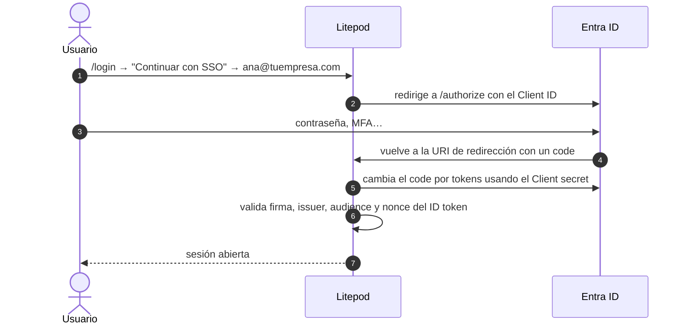

# Login con OIDC (OpenID Connect) y Entra ID

[← SSO: lo común](sso.md) · Alternativa: [SAML](saml.md) · Opcional: [SCIM](scim.md)

## Explicación

### Qué es OIDC

OpenID Connect es un protocolo de login: el usuario inicia sesión en Entra y Entra le entrega a
Litepod un **ID token**, un JSON firmado (JWT) que dice quién es y en qué grupos está. Litepod
comprueba la firma con las claves públicas que Entra publica en su **issuer**.

### OIDC o SAML

Hacen **lo mismo**: se usa **uno de los dos**. OIDC es el **recomendado** con Entra ID: es más
simple que SAML, no necesita librerías nativas, soporta usuarios con más de 200 grupos (vía
Microsoft Graph) y viene en cualquier build de Litepod. SAML solo si el IdP no soporta OIDC o
seguridad lo exige ([saml.md](saml.md)).

### Qué datos se intercambian

| Campo en Litepod | Nombre en Entra | Dónde está en Entra |
|---|---|---|
| **Client ID** | *Application (client) ID* | App → **Overview** |
| **URL del issuer** | `https://login.microsoftonline.com/<Directory (tenant) ID>/v2.0` | *Directory (tenant) ID* en App → **Overview** |
| **Client secret** | *Value* del client secret | App → **Certificates & secrets** |
| **Claim de grupos** | `groups` | App → **Token configuration** |
| **URI de redirección** *(de Litepod a Entra)* | *Redirect URI* (Web) | App → **Authentication** |

Hay varios GUID que se parecen y **no** se usan: **Object ID** (en Overview) y **Secret ID** (en
Certificates & secrets). Confundirlos da `AADSTS700016`.

En otros IdP los nombres cambian:

| Litepod | Entra ID | Okta | Google Workspace | Keycloak |
|---|---|---|---|---|
| **URL del issuer** | `https://login.microsoftonline.com/<tenant-id>/v2.0` | `https://<org>.okta.com` | `https://accounts.google.com` | `https://<host>/realms/<realm>` |
| **Client ID** | Application (client) ID | Client ID | Client ID | Client ID |
| **Client secret** | Client secret → Value | Client secret | Client secret | Credentials → Client secret |
| **URI de redirección** | Redirect URI (Web) | Sign-in redirect URIs | Authorized redirect URIs | Valid redirect URIs |

## Paso a paso

**Antes**: haz los pasos 2, 3 y 4 de [sso.md](sso.md) (requisitos, dominio verificado en Litepod
y en Entra, y un usuario de prueba).

### 1. En Entra: registrar Litepod

Todo en https://entra.microsoft.com.

#### 1.1 Registrar la app

1. **Identity → Applications → App registrations** (*Registros de aplicaciones*) →
   **+ New registration**.
2. Rellena:
   - **Name**: `Litepod`
   - **Supported account types**: *Accounts in this organizational directory only*
     (*Solo las cuentas de este directorio organizativo*).
   - **Redirect URI**: plataforma **Web**, valor `<base>/api/v1/auth/sso/callback`.
     Ejemplo: `https://litepod.tuempresa.com/api/v1/auth/sso/callback`.
3. **Register**.

#### 1.2 Anotar los dos IDs

Se abre la página **Overview** de la app. En el bloque **Essentials** hay tres GUID:

| Campo en Entra | ¿Para qué sirve? |
|---|---|
| **Application (client) ID** | Va en Litepod → **Client ID** |
| **Directory (tenant) ID** | Va dentro de la **URL del issuer** de Litepod |
| **Object ID** | **No se usa.** No lo confundas con el Client ID |

Cópialos con el icono de copiar que aparece al pasar el ratón. Si sales de la app, vuelves por
**App registrations → All applications → Litepod**.

#### 1.3 Crear el secreto

1. Menú de la izquierda de la app, sección **Manage** (*Administrar*) →
   **Certificates & secrets** (*Certificados y secretos*).
2. Pestaña **Client secrets** (*Secretos de cliente*) → **+ New client secret**.
3. En el panel de la derecha: **Description** `litepod`, **Expires** lo que quieras (por defecto
   180 días; hasta 24 meses) → **Add**.
4. Aparece una fila con cuatro columnas:

   | Columna | ¿Para qué sirve? |
   |---|---|
   | **Description** | Solo una etiqueta para ti |
   | **Expires** | Anota la fecha: ese día el login deja de funcionar si no lo renuevas |
   | **Value** | **Va en Litepod → Client secret.** Cópialo ya: se oculta al salir de la página |
   | **Secret ID** | **No se usa.** Es un GUID y se confunde con el Client ID |

Si pierdes el **Value**, no se recupera: crea otro secreto y borra el viejo (icono de papelera).
La pestaña **Certificates** no hace falta para OIDC.

#### 1.4 Hacer que el token traiga los grupos

1. **Manage → Token configuration** (*Configuración de token*) → **+ Add groups claim**.
2. Marca solo **Security groups** (*Grupos de seguridad*).
3. Deja **ID**, **Access** y **SAML** en **Group ID**.
4. **Add**. Aparece una fila con el claim `groups`.

Con esto Entra manda los **Object ID** de los grupos del usuario, que se mapean en
[sso.md → Grupos y roles](sso.md#5-grupos-y-roles).

#### 1.5 Permiso de Graph para usuarios con muchos grupos

Si un usuario está en más de 200 grupos, Entra no los mete en el token y Litepod los pide a
Microsoft Graph.

1. **Manage → API permissions** (*Permisos de API*). Ya aparece `User.Read`: déjalo.
2. **+ Add a permission → Microsoft Graph → Delegated permissions** (no *Application*).
3. Busca `GroupMember`, despliega y marca **GroupMember.Read.All** → **Add permissions**.
4. **Grant admin consent for <tu tenant>** → **Yes**.

Los dos permisos deben quedar con check verde: *Granted for <tu tenant>*. Si el botón está gris,
tu usuario no es administrador del tenant. Sin este permiso el login funciona igual para usuarios
con pocos grupos.

### 2. En Litepod: crear la conexión

#### 2.1 Crear el proveedor de identidad

1. **Organización** → pestaña **Autenticación**.
2. Sección **Proveedores de identidad** → **Agregar proveedor de identidad**.
3. Rellena:

   Cada campo tiene un botón **ⓘ** que explica qué es y cómo se llama en Entra, Okta, Google
   Workspace y Keycloak.

   | Campo en Litepod | Qué pones |
   |---|---|
   | **Nombre** | `Entra ID` |
   | **Protocolo** | **OpenID Connect** (si el selector no aparece, ya es OpenID Connect) |
   | **URL del issuer** | `https://login.microsoftonline.com/<Directory (tenant) ID>/v2.0` |
   | **Client ID** | **Application (client) ID** (un GUID) |
   | **Client secret** | **Value** del secreto (texto con `~` en medio) |
   | **Claim de grupos** | `groups` |
   | **Rol base para miembros nuevos** | El rol mínimo que recibe todo usuario nuevo |
   | **Crear cuentas en el primer inicio de sesión (just-in-time)** | Marcado |
   | **Activado (necesita un dominio verificado)** | Marcado |

4. **Guardar**. Aparece **Conexión guardada**.

Cuidado: el issuer termina en `/v2.0`, sin `/` al final. Y el **Protocolo** no se puede cambiar
después: para pasar a SAML hay que crear otra conexión.

#### 2.2 Comprobar la URI de redirección

1. **Litepod** → conexión `Entra ID` → **Editar**. Copia la **URI de redirección**.
2. **Entra** → app **Litepod** → **Authentication** → **Web → Redirect URIs**.
3. Tienen que ser **idénticas, carácter por carácter**: `https`, mismo dominio, sin `/` final.

Si no coinciden, corrígela en Entra (**Save**), o corrige el dominio en **Settings** de Litepod
(`LITEPOD_PUBLIC_URL`) si Litepod muestra uno equivocado como `localhost`.

#### 2.3 Cambiar datos más tarde

**Editar** en la conexión. El campo **Client secret** aparece vacío: déjalo vacío para conservar
el secreto actual, o pega uno nuevo para reemplazarlo (por ejemplo, cuando caduque).

### 3. Probar

1. Abre una **ventana privada**.
2. `<base>/login` → **Continuar con SSO** → `test@tuempresa.com`.
3. Te lleva al login de Microsoft. Entra con la contraseña del usuario; la primera vez pide
   cambiarla.
4. Si aparece una pantalla de permisos (*consent*), acéptala.
5. Vuelves a Litepod con la sesión abierta, dentro de la organización y con el **Rol base**.

Que entre sin acceso a nada es normal: sigue con
[sso.md → Grupos y roles](sso.md#5-grupos-y-roles).

### 4. Si falla

Los errores `AADSTS…` los muestra Microsoft; los demás, Litepod. En Entra,
**Identity → Monitoring & health → Sign-in logs** muestra cada intento con el motivo exacto.

| Síntoma | Causa | Arreglo |
|---|---|---|
| Litepod dice que no hay SSO para ese correo | El dominio del correo no está verificado en Litepod, o la conexión no está **Activado** | [sso.md → dominio](sso.md#3-verificar-el-dominio-de-correo) y 2.1 |
| `AADSTS700016: Application with identifier 'xxx~xxx…' was not found` (con `~`) | En **Client ID** pegaste el **Value** del secreto | Pega el **Application (client) ID**. Crea un secreto nuevo y borra el viejo: ese valor viajó en la URL y ya no es privado |
| `AADSTS700016: Application with identifier '<GUID>' was not found` | En **Client ID** pegaste el **Secret ID** o el **Object ID** | Pega el **Application (client) ID** de **Overview** |
| `AADSTS700016` y el GUID sí es el Application (client) ID | La app está en otro tenant que el del issuer | Compara el **Directory (tenant) ID** de la app con el del issuer |
| `AADSTS50011: The redirect URI … does not match` | La URI de redirección no coincide | 2.2 |
| `AADSTS50020` / `AADSTS50034`: el usuario no existe | El usuario no está en el tenant de la app | Créalo en ese tenant ([sso.md → usuarios](sso.md#4-crear-usuarios-en-entra)) |
| `AADSTS7000215: Invalid client secret` | En **Client secret** pegaste el **Secret ID**, o el secreto caducó | Pega el **Value** de un secreto vigente (2.3) |
| Vuelves a Litepod con error tras el login de Microsoft | Issuer sin `/v2.0`, o con otro tenant | Revisa la **URL del issuer** |
| Litepod rechaza al usuario aunque Microsoft lo aceptó | El correo/UPN no es del dominio verificado, o JIT está apagado y el usuario no existe en Litepod | Revisa UPN y **Email** del usuario en Entra, o marca JIT |

## Checklist

- [ ] App registrada con Redirect URI `<base>/api/v1/auth/sso/callback` (Web).
- [ ] Secreto creado; **Value** guardado y fecha de caducidad anotada.
- [ ] Claim `groups` en **Token configuration**.
- [ ] `GroupMember.Read.All` con admin consent.
- [ ] Conexión en Litepod **Activado**, con la URI de redirección idéntica a la de Entra.
- [ ] `test@tuempresa.com` entra por **Continuar con SSO**.
