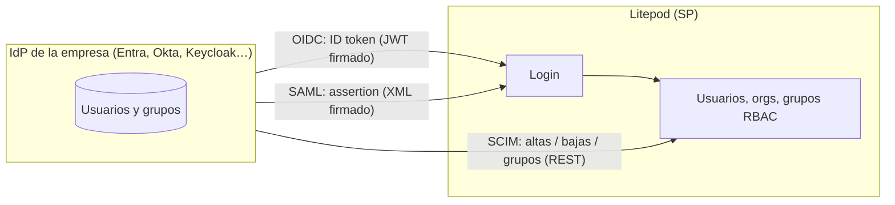
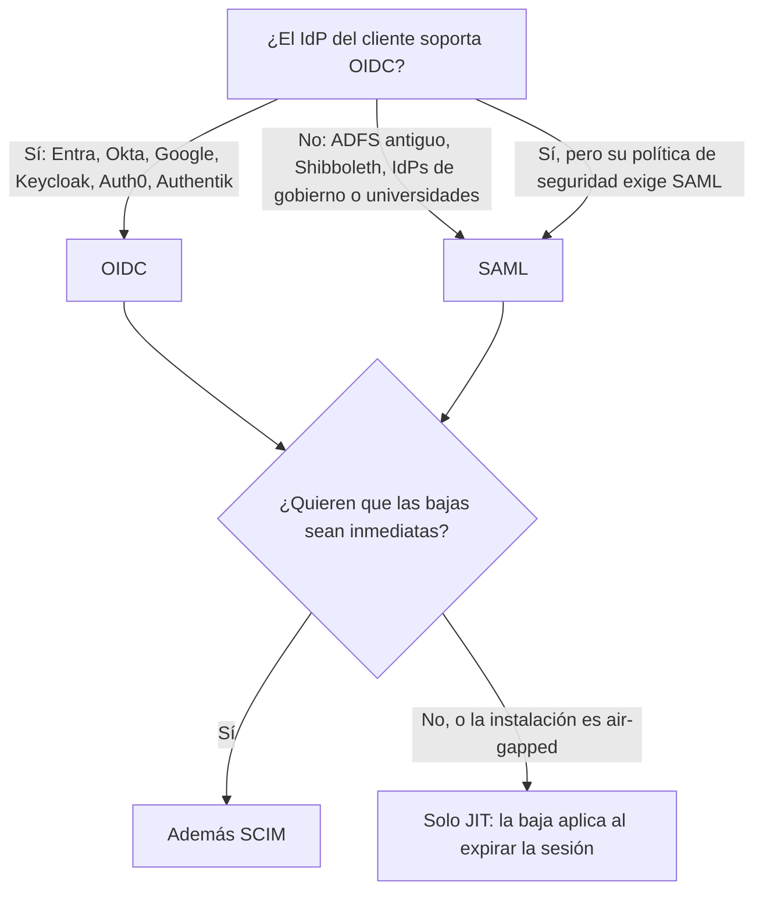
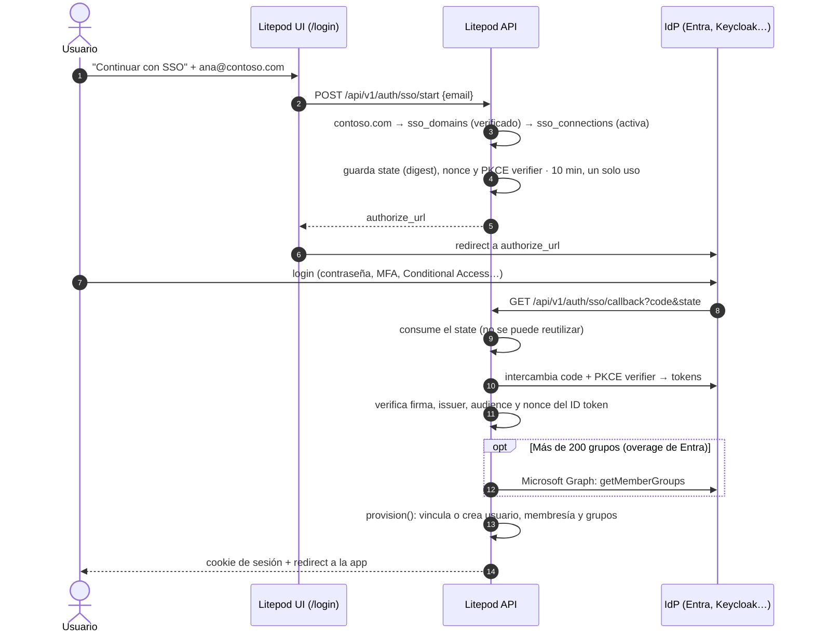
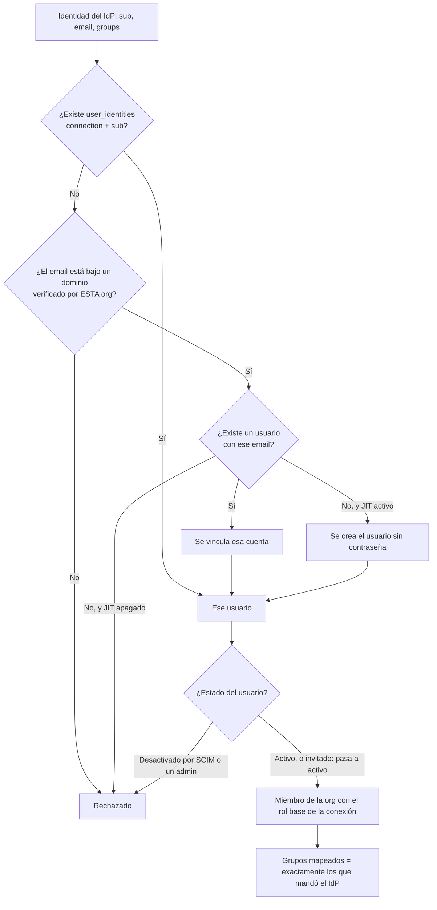
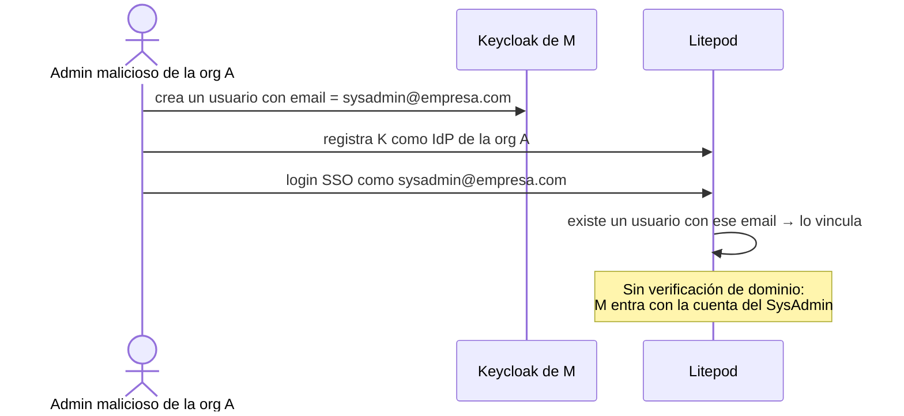

# SSO: referencia técnica

Cómo funciona el SSO por dentro, licencias de Entra, Keycloak local para desarrollo y checklist de
pruebas. Para configurarlo paso a paso, ve al [índice](sso.md).

> Estado: OIDC, JIT, mapeo de grupos, SCIM, enforcement y SAML implementados. SAML va detrás del
> feature de cargo `saml`: apagado en un `cargo build` local, encendido en las imágenes de release.
> Solo self-hosted: en cloud estas rutas no existen.

## Cómo funciona (explicación)

### SSO, OIDC, SAML y SCIM: qué es cada cosa

**SSO** (*single sign-on*) no es un protocolo: es la idea de que la empresa autentica a sus usuarios
en un solo sitio, el **IdP** (*identity provider*: Entra ID, Okta, Keycloak, Google Workspace), y las
apps (los **SP** o *service providers*, aquí Litepod) confían en lo que el IdP les dice. **OIDC** y
**SAML** son los dos protocolos con los que el IdP le cuenta a Litepod quién es el usuario. **SCIM** es
otra cosa: el IdP le *empuja* a Litepod altas, bajas y cambios de grupo, sin que nadie inicie sesión.



| | OIDC | SAML 2.0 | SCIM 2.0 |
|---|---|---|---|
| Para qué | Login | Login | Provisioning (ciclo de vida) |
| Formato | JSON / JWT | XML firmado (XML-DSig) | JSON sobre REST |
| Quién inicia | El usuario, al hacer login | El usuario, al hacer login | El IdP, cuando cambia algo |
| Configuración en Litepod | issuer + client ID + secret | metadata XML del IdP | token bearer |
| Dependencias | Ninguna nativa | libxml2 + xmlsec1 (feature `saml`) | Ninguna |
| Antigüedad | 2014, moderno | 2005, enterprise clásico | 2015 |

### Cuándo usar OIDC y cuándo SAML

Los dos resuelven lo mismo (login). La decisión la toma **el cliente según lo que soporte su IdP**,
no Litepod:



Regla práctica: **por defecto OIDC**. Es más simple de configurar, no necesita librerías nativas y
casi todos los IdP modernos lo traen. SAML existe en Litepod porque hay empresas grandes cuyo
equipo de seguridad solo aprueba SAML.

### Flujo de login (OIDC)

El correo decide la conexión: Litepod busca un **dominio verificado** que coincida con la parte de
después de la `@` y usa la conexión activa de esa organización.



SAML sigue el mismo esquema, cambian los pasos 9-11: el IdP hace un POST del `SAMLResponse` a la
**ACS URL** y Litepod valida la firma XML, el audience, el destination y el `InResponseTo`.

### Qué hace `provision()` con la identidad



### Por qué existe la verificación de dominio

Litepod es **multi-organización** y cada org configura **su propio IdP**. El paso
"se vincula esa cuenta" (por email) es lo que hace peligrosa una conexión sin dominio verificado:



La verificación cierra eso: una org solo puede iniciar sesión, vincular, crear (JIT o SCIM) o exigir
SSO a correos de dominios que **probó** que controla. Además, `sso_domains.domain` es `UNIQUE`: dos
orgs no pueden reclamar el mismo dominio, así que el ruteo correo → conexión no es ambiguo.

### Comparación con Coolify 4.4.0 (octubre 2026)

Coolify añadió login OIDC en 4.4.0 (PR #10543) sin verificación de dominio. Lo puede omitir porque
su modelo es más chico:

| | Coolify 4.4.0 | Litepod |
|---|---|---|
| Protocolos | Solo OIDC | OIDC + SAML |
| Quién configura el IdP | El admin de la instancia (uno global) | Cada organización (`org.sso.manage`) |
| Vínculo de la identidad | `issuer` + `sub` | `connection` + `sub`; el primer login vincula por email |
| Confianza en el email | `require_email_verified` (en Entra, claim `xms_edov`) | Dominio verificado por la org |
| Usuarios nuevos | Política de registro por proveedor; opción de unirlos al Root team | JIT con rol base por conexión |
| Grupos → roles | No | Sí (por Object ID) + overage vía Graph |
| SCIM | No | Sí |
| Exigir SSO | No | Sí, con break-glass del SysAdmin |

Si solo el dueño de la instancia puede configurar el IdP, el IdP ya es de confianza y no hace
falta probar dominios. En Litepod cualquier org puede traer su propio IdP, y por eso sí hace falta.

### Simplificaciones posibles

1. **Aprobación del dominio por el SysAdmin, sin DNS** *(recomendada)*. SSO solo existe en
   self-hosted, donde el SysAdmin ya es de confianza total. Un botón "Aprobar" en la vista del
   SysAdmin marca `verified_at` y el TXT queda como camino opcional para que una org se
   autoverifique. Elimina el `sqlite3 UPDATE` para `onmicrosoft.com` y el ida y vuelta con DNS.
   No hace falta migración: es la misma columna `verified_at`.
2. **Instalación de una sola org = verificación implícita**. Si la instancia tiene una única
   organización, quien la administra es en la práctica el dueño de la instancia: el dominio
   podría marcarse verificado al agregarlo. Es el caso de Coolify.
3. **No vincular por email cuentas que ya existen**. Con JIT solo se crean usuarios nuevos y una
   cuenta existente se vincula desde su propia sesión ("Conectar SSO" en el perfil). Quita el
   riesgo del diagrama de arriba, pero **no** permite quitar la verificación: JIT y SCIM seguirían
   pudiendo crear cuentas con cualquier correo, y el ruteo correo → conexión necesita que el
   dominio sea de una sola org.

### Qué falta o conviene revisar

- **`email_verified` no se exige** en OIDC, y el email puede venir de `preferred_username` (en
  Entra es el UPN). Con el dominio verificado el riesgo está acotado al propio IdP de la org, pero
  Coolify sí lo exige; conviene requerir `email_verified` o, en Entra, `xms_edov`.
- **Sin Single Logout**: cerrar sesión en Litepod no cierra la del IdP y viceversa. Sin SCIM, la
  baja en el IdP solo surte efecto cuando expira la sesión de Litepod.
- **SAML solo SP-initiated**: no se puede entrar desde el portal del IdP (por ejemplo "Mis apps"
  de Microsoft). Es lo que muchos usuarios de Entra esperan.
- **Solo un IdP activo por dominio**: una empresa con dos IdPs para el mismo dominio
  (migraciones de Okta a Entra) necesita apagar uno para encender el otro.

## SAML: compilar

- Compilar con `--features saml`. Necesita libxml2 + xmlsec1 nativos: Debian `libxmlsec1-dev pkg-config`
  (runtime `libxmlsec1`); macOS `brew install libxmlsec1 libxslt pkgconf`. Tests: `just api-test-saml`.
- En macOS la receta pone primero las rutas de pkg-config de Homebrew: el SDK trae otra libxml2 y
  enlazar las dos hace que xmlsec se caiga (SIGSEGV).
- Configuración en Entra: [saml.md](saml.md).

## Desarrollo local

- El issuer debe ser HTTPS. Para Keycloak por `http://localhost:8080` arranca la API con
  `LITEPOD_DEV_MODE=1`.
- La URI de redirección en dev es `http://localhost:6001/api/v1/auth/sso/callback`; Entra acepta
  `http://localhost` sin HTTPS.
- Tras el login, el callback redirige a `<base>/` (en dev `http://localhost:6001/`). La cookie
  ya quedó puesta para `localhost`; abre `http://localhost:6002`.
- Dominio sin DNS propio: `sqlite3 api/data/litepod.db "UPDATE sso_domains SET verified_at = datetime('now') WHERE domain = '<dominio>'"`.

## Qué usar para qué

| Necesidad | Herramienta |
|---|---|
| Desarrollo diario y tests de integración (OIDC, SAML, grupos) | Keycloak local en Podman |
| Validar el comportamiento real de Microsoft (claims, overage de grupos, Graph, SCIM) | Tenant propio de Entra ID |

## ¿Sirve el Azure DevOps de un compañero?

Por lo general, no. Azure DevOps no es un IdP: detrás tiene un tenant de Entra ID, normalmente el de la empresa.
Para estas pruebas hace falta:

- registrar una app;
- dar admin consent a `GroupMember.Read.All`;
- crear usuarios y grupos;
- configurar el provisioning SCIM.

En un tenant corporativo casi nunca se tienen esos permisos.
Solo sirve si ese tenant es personal y te asigna el rol **Global Administrator** o **Application Administrator**.
Aun así, es mejor tener un tenant propio que se pueda romper.

## 1. Entra ID + Litepod

La guía paso a paso está en [sso.md](sso.md) (lo común), [oidc.md](oidc.md), [saml.md](saml.md) y [scim.md](scim.md).

### Probar el token sin Litepod (opcional)

Para comprobar los claims antes de que exista el código:
https://oidcdebugger.com con el authorize endpoint
`https://login.microsoftonline.com/<tenant-id>/oauth2/v2.0/authorize`, scope `openid profile email`
y response type `id_token`.
Antes, añade `https://oidcdebugger.com/debug` como redirect URI de la app y activa
**ID tokens** en Authentication. Revisa que el token traiga `oid`, `email` y `groups`.

## 2. Licencias: qué cubre Free y qué requiere P1/P2

| Funcionalidad | Free | P1/P2 |
|---|---|---|
| Usuarios, grupos de seguridad, app registration, OIDC, groups claim | Sí | Sí |
| Asignar grupos a una Enterprise App | — | Sí |
| Provisioning SCIM a una app custom (non-gallery) | Verificar en la doc de Microsoft al llegar a esa fase | Sí |
| Conditional Access (MFA por política) | — | Sí |

Para la fase de SCIM, activa el **trial gratis de 30 días de Entra ID P2** desde
**Entra → Billing → Licenses → All products → Try/Buy**. Actívalo solo al llegar a esa fase
para que no venza antes.

## 3. SCIM

Ver [scim.md](scim.md). Para probarlo desde local hace falta un túnel
(`cloudflared tunnel --url http://localhost:6001` o `ngrok http 6001`): Entra no llega a `localhost`.

## 4. Keycloak local (desarrollo diario, sin cuenta ni internet)

```bash
podman run -d --name keycloak -p 8081:8080 \
  -e KC_BOOTSTRAP_ADMIN_USERNAME=admin \
  -e KC_BOOTSTRAP_ADMIN_PASSWORD=admin \
  quay.io/keycloak/keycloak start-dev
```

En http://localhost:8081, con usuario `admin`/`admin`:

1. Crea el realm `litepod`.
2. **Users**: crea `dev1` y `admin1`, con email y la opción *Email verified* activada. En
   **Credentials**, asígnales una contraseña no temporal.
3. **Groups**: crea `litepod-admins` y `litepod-devs` y asigna los usuarios.
4. **Clients → Create client**, de tipo OpenID Connect, con client ID `litepod`:
   - Client authentication: On.
   - Valid redirect URIs: `http://localhost:6001/api/v1/auth/sso/callback`.
   - En **Credentials**, copia el client secret.
5. **Client scopes → litepod-dedicated → Add mapper → By configuration → Group Membership**:
   token claim name `groups` y *Full group path* en Off.

Datos para Litepod:

| Campo | Valor |
|---|---|
| Issuer | `http://localhost:8081/realms/litepod` |
| Client ID | `litepod` |
| Client secret | El de **Credentials** |
| Groups claim | `groups` (Keycloak envía nombres; Entra envía Object IDs) |

Para SAML, crea en el mismo realm otro client de tipo **SAML** con
entity ID = `http://localhost:6001/api/v1/auth/saml/<connection_id>/metadata`.

### Qué cubre Keycloak y qué no

| Caso | ¿Se simula con Keycloak? | Cómo |
|---|---|---|
| Login OIDC, PKCE, JIT y mapeo de grupos | Sí | Configuración base de arriba |
| SAML | Sí | Client de tipo SAML |
| Grupos por ID, como Entra | Sí | Mapper que emita el atributo de usuario o el ID de grupo en `groups`, en lugar del nombre |
| Overage de grupos (>200) | Parcial | Mapper **Hardcoded claim** con `_claim_names`/`_claim_sources`. La llamada a Graph se prueba con un mock HTTP |
| AD on-prem | Sí | **User federation → LDAP** contra un contenedor Samba AD u OpenLDAP; Keycloak lo expone como OIDC |
| SCIM (el IdP empuja altas y bajas) | No de forma nativa | Requiere un plugin, o probar con `curl` o con el validador SCIM de Microsoft directamente contra Litepod |
| Comportamiento exacto de Entra (formato de claims, consent, provisioning) | No | Tenant real de Entra |

## 5. Checklist de pruebas

- [ ] Login OIDC con `dev1` → se crea el usuario por JIT y entra en la org.
- [ ] `dev1` en `litepod-devs` → recibe el rol asignado a ese grupo en Litepod.
- [ ] Sacar `dev1` del grupo en el IdP y volver a hacer login → pierde el rol.
- [ ] Un dominio no verificado no puede iniciar SSO.
- [ ] Con *Exigir SSO* activo, el login por contraseña se rechaza; el SysAdmin sigue entrando con contraseña y TOTP.
- [ ] (Entra) Usuario con más de 200 grupos → Litepod los obtiene vía Graph.
- [ ] (Entra + túnel) SCIM: alta crea el usuario; baja revoca sesiones y PAT.
- [ ] (SAML) Assertion sin firma o con audience incorrecto → rechazada.
