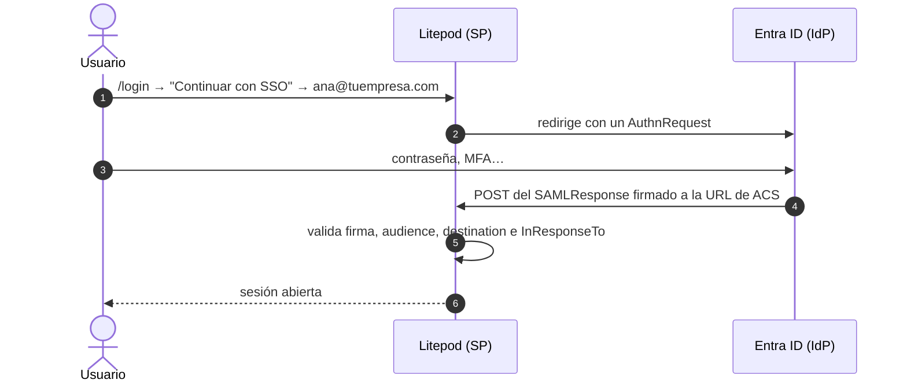

# Login con SAML 2.0 y Entra ID

[← SSO: lo común](sso.md) · Alternativa recomendada: [OIDC](oidc.md) · Opcional: [SCIM](scim.md)

## Explicación

### Qué es SAML

SAML es un protocolo de login, igual que OIDC: el usuario inicia sesión en Entra y Entra le
entrega a Litepod una **assertion**, un XML firmado que dice quién es y en qué grupos está.
Litepod comprueba la firma con el certificado que viene en los **metadatos** del IdP.

### SAML u OIDC

Hacen **lo mismo**: se usa **uno de los dos**. Con Entra ID **recomendamos OIDC**
([oidc.md](oidc.md)). Usa SAML solo si:

- tu IdP no soporta OIDC (ADFS antiguo, Shibboleth, IdPs de gobierno o universidades), o
- el equipo de seguridad de la empresa solo aprueba SAML.

Limitaciones frente a OIDC:

- Solo **SP-initiated**: se entra desde `<base>/login`, no desde el portal *Mis apps* de
  Microsoft.
- Sin overage de grupos: si un usuario está en más de 200 grupos, no se consultan en Graph.
- Requiere la build con SAML: viene en las imágenes de release. En un `cargo build` local hay que
  compilar con `--features saml` (necesita `libxmlsec1`). Si en Litepod no aparece el selector
  **Protocolo**, tu build no tiene SAML.

### Qué datos se intercambian

| Dato | Lo da | Se pega en | Nombre en Entra |
|---|---|---|---|
| **XML de metadatos de federación del IdP** | Entra | Litepod | *Federation Metadata XML* |
| **Identificador (Entity ID)** | Litepod | Entra | *Identifier (Entity ID)* |
| **URL de ACS (Reply URL)** | Litepod | Entra | *Reply URL (Assertion Consumer Service URL)* |
| **Claim de grupos** | Fijo | Litepod | `http://schemas.microsoft.com/ws/2008/06/identity/claims/groups` |

Hay un orden obligado: Litepod pide el XML de Entra **al crear** la conexión, y el **Entity ID**
de Litepod lleva el ID de la conexión, que solo existe después de crearla. Por eso se configura
Entra con un identificador provisional y se corrige al final (paso 3).

## Paso a paso

**Antes**: haz los pasos 2, 3 y 4 de [sso.md](sso.md) (requisitos, dominio verificado en Litepod
y en Entra, y un usuario de prueba). Si ya tienes una conexión OIDC activa para el mismo dominio,
desactívala: solo puede haber **una conexión activa por dominio**.

### 1. Crear la aplicación empresarial en Entra

Es una *Enterprise application*, no un *App registration* como en OIDC.

1. **Entra** → **Identity → Applications → Enterprise applications** → **+ New application**.
2. **+ Create your own application** → nombre `Litepod` → *Integrate any other application you
   don't find in the gallery (Non-gallery)* → **Create**.
3. En la app → **Single sign-on** → **SAML**.
4. **Basic SAML Configuration** → **Edit**:
   - **Identifier (Entity ID)**: provisional, por ejemplo `<base>/saml-provisional`.
   - **Reply URL (Assertion Consumer Service URL)**: `<base>/api/v1/auth/saml/acs`.
   - **Save**.
5. **Attributes & Claims** → **Edit** → **+ Add a group claim** → **Security groups**,
   *Source attribute*: **Group ID** → **Save**.
6. **SAML Certificates** → **Federation Metadata XML** → **Download**.
7. **Users and groups** → **+ Add user/group** → asigna los usuarios o grupos que podrán entrar.
   Asignar grupos puede requerir Entra ID P1/P2; usuarios sueltos funcionan con Free.

### 2. Crear la conexión en Litepod

1. **Litepod** → **Organización** → **Autenticación** → **Agregar proveedor de identidad**.
2. Rellena:

   Cada campo tiene un botón **ⓘ** que explica qué es y cómo se llama en Entra, Okta, Google
   Workspace y Keycloak.

   | Campo en Litepod | Qué pones |
   |---|---|
   | **Nombre** | `Entra ID SAML` |
   | **Protocolo** | **SAML 2.0** |
   | **XML de metadatos de federación del IdP** | El contenido completo del XML descargado (abre el archivo y copia todo) |
   | **Claim de grupos** | `http://schemas.microsoft.com/ws/2008/06/identity/claims/groups` |
   | **Rol base para miembros nuevos** | El rol mínimo |
   | **Crear cuentas en el primer inicio de sesión (just-in-time)** | Marcado |
   | **Activado (necesita un dominio verificado)** | Marcado |

3. **Guardar**, y luego **Editar**: copia el **Identificador (Entity ID)** y la
   **URL de ACS (Reply URL)**.

### 3. Poner el identificador real en Entra

1. **Entra** → app `Litepod` → **Single sign-on** → **Basic SAML Configuration** → **Edit**.
2. **Identifier (Entity ID)**: reemplaza el provisional por el **Identificador (Entity ID)** de
   Litepod (`<base>/api/v1/auth/saml/<connection_id>/metadata`).
3. Comprueba que **Reply URL** es igual a la **URL de ACS** de Litepod → **Save**.

No hace falta volver a descargar el XML: cambiar el identificador no cambia los metadatos de
Entra.

### 4. Probar

1. Ventana privada → `<base>/login` → **Continuar con SSO** → `test@tuempresa.com`.
2. Te lleva al login de Microsoft; entra con la contraseña del usuario.
3. Vuelves a Litepod con la sesión abierta y el **Rol base**.

Después sigue con [sso.md → Grupos y roles](sso.md#5-grupos-y-roles).

### 5. Si falla

| Síntoma | Causa |
|---|---|
| `AADSTS700016` con el Entity ID | El **Identifier** de Entra no coincide con el de Litepod (paso 3) |
| `AADSTS50011` | La **Reply URL** de Entra no coincide con la **URL de ACS** |
| `AADSTS50105`: el usuario no está asignado | No está asignado en **Users and groups** (paso 1.7) |
| Litepod rechaza el metadata | Le falta el certificado de firma, o la firma es SHA-1 |
| Litepod rechaza la respuesta | Audience o destination no coinciden: revisa Entity ID y ACS |
| No se puede activar la conexión | Hay otra conexión activa para el mismo dominio, o el dominio no está verificado |

## Checklist

- [ ] Enterprise application con SAML, Reply URL `<base>/api/v1/auth/saml/acs`.
- [ ] Claim de grupos **Security groups / Group ID**.
- [ ] Usuarios o grupos asignados en **Users and groups**.
- [ ] Conexión SAML en Litepod con el XML pegado y **Activado**.
- [ ] **Identifier** de Entra = **Identificador (Entity ID)** de Litepod.
- [ ] `test@tuempresa.com` entra por **Continuar con SSO**.
