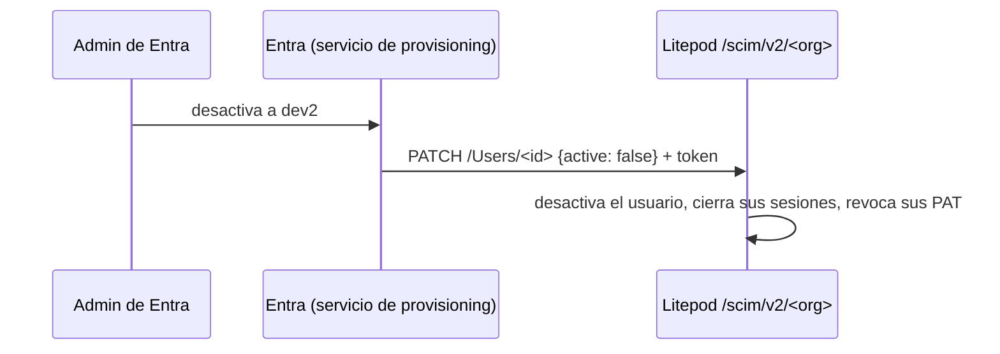

# SCIM: altas y bajas automáticas con Entra ID

[← SSO: lo común](sso.md) · Login: [OIDC](oidc.md) o [SAML](saml.md)

## Explicación

### Qué es SCIM

SCIM **no es un login**. OIDC y SAML se usan cuando el usuario inicia sesión. SCIM va en la otra
dirección: **Entra llama a Litepod** cada vez que creas, desactivas o cambias de grupo a alguien,
aunque esa persona nunca inicie sesión.

Se usa **además de** OIDC o SAML, nunca en su lugar: los usuarios siguen entrando por SSO.

| | Sin SCIM (solo JIT) | Con SCIM |
|---|---|---|
| Alta | Al primer login | Al asignarlo en Entra |
| Baja | Cuando expira su sesión en Litepod | Inmediata: se cierran sus sesiones y se revocan sus PAT |
| Cambio de grupo | En el siguiente login | Inmediato |

### ¿Lo necesito?

- **Sí**, si las bajas tienen que ser inmediatas (alguien sale de la empresa y no debe poder
  seguir desplegando con una sesión abierta o un PAT).
- **No**, si te basta con que la baja surta efecto al expirar la sesión, o si la instalación es
  air-gapped (Entra no puede llegar a ella).

### Grupos con SCIM

Con SCIM, Entra **crea los grupos en Litepod** con su mismo nombre (aparecen en **Acceso**
marcados como **SCIM**) y mantiene sus miembros. Tú solo les asignas roles en **Acceso**. No hace
falta el mapeo de grupos de [sso.md](sso.md#5-grupos-y-roles) para esos grupos.

### Qué datos se intercambian

| Dato en Litepod | Nombre en Entra |
|---|---|
| **URL del tenant** (`<base>/scim/v2/<organization_id>`) | *Tenant URL* |
| **Token secreto** | *Secret Token* |

## Requisitos

- **OIDC o SAML ya funcionando** ([oidc.md](oidc.md) o [saml.md](saml.md)).
- La instancia tiene que ser **pública por HTTPS** con un certificado válido. El servicio de
  provisioning de Entra corre en la nube de Microsoft: no llega a `localhost` ni a una red
  privada. Para probar en local sirve un túnel (`cloudflared tunnel --url http://localhost:6001`
  o `ngrok http 6001`).
- Puede requerir **Entra ID P1/P2**. Hay un trial gratis de 30 días en **Entra → Billing →
  Licenses → All products → Try/Buy**; actívalo justo antes de empezar.

## Paso a paso

### 1. Generar el token en Litepod

1. **Litepod** → **Organización** → **Autenticación** → **Aprovisionamiento SCIM** →
   **Activar SCIM**.
2. Copia **URL del tenant** y **Token secreto**. El token **no se vuelve a mostrar**; si lo
   pierdes, **Generar token nuevo** (el anterior deja de valer).

### 2. Crear la aplicación empresarial en Entra

Es una app distinta de la de OIDC (allí era *App registrations*; aquí *Enterprise
applications*). Si usas SAML, puedes usar la misma Enterprise application de SAML.

1. **Entra** → **Identity → Applications → Enterprise applications** → **+ New application**.
2. **+ Create your own application** → nombre `Litepod SCIM` → *Integrate any other application
   you don't find in the gallery (Non-gallery)* → **Create**.
3. **Provisioning** → **Get started** (o **New configuration**) → **Provisioning Mode:
   Automatic**.
4. **Admin Credentials**:
   - **Tenant URL**: la **URL del tenant** de Litepod.
   - **Secret Token**: el **Token secreto** de Litepod.
   - **Test Connection** → debe salir en verde.
5. **Save**.

### 3. Asignar usuarios y grupos

1. En la app `Litepod SCIM` → **Users and groups** → **+ Add user/group**.
2. Agrega `litepod-admins` y `litepod-devs` → **Assign**.

Solo se aprovisiona lo que esté asignado aquí.

### 4. Encender

1. **Provisioning** → **Provisioning Status: On** → **Save**.
2. El primer ciclo tarda unos 40 minutos. Para probar al instante:
   **Provision on demand** → elige un usuario → **Provision**.

### 5. Dar roles a los grupos

1. **Litepod** → **Organización** → **Acceso**: aparecen los grupos que creó Entra, marcados
   como **SCIM**.
2. Asigna a cada uno sus roles.

### 6. Probar la baja

1. En Entra desactiva un usuario (**Edit properties → Settings → Account enabled: No**) o
   quítalo de la app.
2. **Provision on demand** con ese usuario.
3. En Litepod sus sesiones y sus PAT deben desaparecer, y ya no puede entrar.

### 7. Si falla

Los detalles de cada intento están en **Provisioning → View provisioning logs**.

| Síntoma | Causa |
|---|---|
| **Test Connection** falla con timeout | La URL no es pública o no tiene HTTPS válido |
| **Test Connection** devuelve 401 | Token mal copiado o ya rotado |
| No se crea nada | Provisioning en **Off**, o nada asignado en **Users and groups** |
| Usuario rechazado al crearse | Su correo no es de un dominio verificado en Litepod |
| Los grupos aparecen pero sin permisos | Falta asignarles roles en **Acceso** (paso 5) |

## Checklist

- [ ] SCIM activado en Litepod; token guardado.
- [ ] **Test Connection** en verde.
- [ ] Usuarios y grupos asignados; **Provisioning Status: On**.
- [ ] Los grupos SCIM tienen roles en **Acceso**.
- [ ] Desactivar un usuario en Entra lo saca de Litepod.
