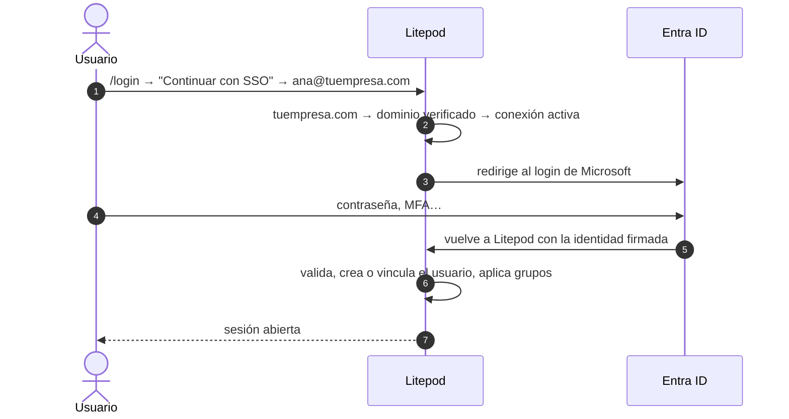

# SSO en Litepod

Guía para que los usuarios de una organización entren a Litepod con la cuenta de su empresa
(Microsoft Entra ID, Okta, Keycloak…). Solo existe en **self-hosted**: en cloud estas pantallas
no aparecen.

Este documento cubre lo que es común a cualquier protocolo: elegir protocolo, verificar el
dominio, crear usuarios, grupos y exigir SSO. El login en sí se configura en
[oidc.md](oidc.md) o [saml.md](saml.md), y el aprovisionamiento en [scim.md](scim.md).

## 1. SSO, OIDC, SAML y SCIM: ¿cuál uso?

**SSO no es un método más: es el objetivo.** SSO (*single sign-on*) quiere decir "entrar con la
cuenta de la empresa". Para conseguirlo, el proveedor de identidad (**IdP**: Entra, Okta…) y
Litepod tienen que hablar con un protocolo:

| | Qué es | ¿Lo necesito? | Guía |
|---|---|---|---|
| **OIDC** (OpenID Connect) | Protocolo de login, moderno (JSON) | **Sí. Es la opción por defecto.** | [oidc.md](oidc.md) |
| **SAML 2.0** | Protocolo de login, clásico (XML) | Solo si el IdP no soporta OIDC o seguridad exige SAML | [saml.md](saml.md) |
| **SCIM 2.0** | No es login: el IdP avisa a Litepod de altas, bajas y cambios de grupo | Opcional, encima de OIDC o SAML | [scim.md](scim.md) |

- **OIDC y SAML hacen lo mismo**: se elige **uno** de los dos. Con cualquiera de ellos, el
  resultado es SSO.
- **SCIM se suma**, no reemplaza. Sin SCIM, si das de baja a alguien en el IdP, la baja surte
  efecto cuando expira su sesión de Litepod. Con SCIM es inmediata.

Recomendación con Entra ID: **OIDC**, y SCIM más adelante si lo necesitas.

### Guías por proveedor

| IdP | Protocolo | Guía |
|---|---|---|
| Microsoft Entra ID (Azure AD) | OIDC | [oidc.md](oidc.md) |
| Microsoft Entra ID (Azure AD) | SAML | [saml.md](saml.md) |
| Keycloak | OIDC | [keycloak.md](keycloak.md) |
| Authentik | OIDC | [authentik.md](authentik.md) |
| Logto | OIDC (sin grupos) | [logto.md](logto.md) |
| Keycloak (SAML gratis) | SAML | [saml-config.md](saml-config.md) |

### Orden de trabajo

1. [Requisitos](#2-requisitos)
2. [Verificar el dominio](#3-verificar-el-dominio-de-correo) (este documento)
3. [Crear usuarios en Entra](#4-crear-usuarios-en-entra) (este documento)
4. Configurar el login: [oidc.md](oidc.md) **o** [saml.md](saml.md), y probarlo
5. [Grupos y roles](#5-grupos-y-roles) (este documento)
6. *(Opcional)* [Exigir SSO](#6-exigir-sso-opcional) (este documento)
7. *(Opcional)* [SCIM](scim.md)

### Cómo funciona el login



El **correo decide** qué conexión se usa: Litepod mira lo que va después de la `@`, busca ese
dominio entre los verificados y usa la conexión asignada a ese dominio (selector junto al dominio
en **Autenticación → Dominios**). Si el dominio no tiene conexión asignada, usa la conexión activa
**más antigua** de la organización. Con varias conexiones (por ejemplo Entra y Keycloak), asigna
cada dominio a la suya; si la asignada está desactivada, ese dominio no tiene SSO.

## 2. Requisitos

- Una **instancia de Litepod self-hosted** con su dominio público configurado en **Settings**
  (o `LITEPOD_PUBLIC_URL`). En estas guías la llamamos `<base>`, por ejemplo
  `https://litepod.tuempresa.com`.
- Un usuario de Litepod con el permiso `org.sso.manage` (el admin de la organización lo tiene).
- Un tenant de **Entra ID** donde seas administrador (*Global Administrator* o *Application
  Administrator*). **Entra ID Free** alcanza para OIDC; SAML con grupos asignados y SCIM pueden
  pedir P1/P2. Una cuenta gratis se crea en https://azure.microsoft.com/free.
- Acceso al **DNS** del dominio de correo de tus usuarios (por ejemplo `tuempresa.com`).

Si tienes más de un tenant, comprueba arriba a la derecha (⚙️ **Settings → Directories +
subscriptions**) que siempre trabajas en el mismo: el dominio, los usuarios y la app tienen que
estar en el mismo tenant.

## 3. Verificar el dominio de correo

El dominio se verifica **dos veces**, una en cada lado:

- **En Litepod**: para probar que la organización es dueña de los correos `@tuempresa.com`. Sin
  esto, Litepod no deja iniciar sesión por SSO con esos correos.
- **En Entra**: para poder crear usuarios `algo@tuempresa.com` en Microsoft.

Ninguna de las dos toca tu correo: no hay que cambiar los registros **MX** ni mover los buzones.

### 3.1 En Litepod

1. **Litepod** → **Organización** → pestaña **Autenticación**.
2. Sección **Dominios** → **Agregar dominio** → escribe `tuempresa.com`.
3. Litepod muestra un registro TXT: **Host** (`_litepod-verify`) y **Valor**.
4. En tu panel DNS crea un registro **TXT**:
   - Host / Nombre: `_litepod-verify`
   - Valor: el que muestra Litepod.

   La mayoría de los paneles DNS agregan el dominio solos. Si el tuyo pide el nombre completo,
   usa `_litepod-verify.tuempresa.com`.
5. Espera un par de minutos y pulsa **Verificar**. Debe aparecer **tuempresa.com verificado**.

Si **Verificar** falla, el DNS todavía no se propagó: `dig +short TXT _litepod-verify.tuempresa.com`.

### 3.2 En Entra

1. **Entra** (https://entra.microsoft.com) → **Identity → Settings → Domain names**
   (*Nombres de dominio*).
2. **+ Add custom domain** → `tuempresa.com` → **Add domain**.
3. Entra muestra un TXT con un valor tipo `MS=ms12345678`.
4. En tu DNS crea un **TXT** en la raíz (Host `@`) con ese valor. Puedes tener varios TXT en la
   raíz: **no borres** el SPF ni otros. **No cambies los MX**, aunque Entra los ofrezca.
5. Vuelve a Entra y pulsa **Verify**. Si falla, espera unos minutos y reintenta.

### 3.3 Sin dominio propio: `onmicrosoft.com`

Para probar sin dominio, usa el que Entra trae por defecto, `<tenant>.onmicrosoft.com` (en
**Entra → Overview**). En Entra ya está verificado; en Litepod no se puede verificar por DNS.
Agrégalo en Litepod (3.1, puntos 1 y 2) y márcalo verificado en la base de datos de la instancia
(`DATABASE_PATH`, por defecto `./data/litepod.db` junto a la API):

```bash
sqlite3 <ruta>/litepod.db \
  "UPDATE sso_domains SET verified_at = datetime('now') WHERE domain = '<tenant>.onmicrosoft.com'"
```

## 4. Crear usuarios en Entra

¿Puedo usar un correo que ya tengo, que no está en Microsoft? Sí, pero **tiene que existir como
usuario en Entra**. Litepod usa el correo solo para elegir la conexión; quien comprueba la
contraseña es Microsoft. El buzón no importa: el usuario de Entra es solo una identidad, y tu
correo sigue funcionando donde está.

1. **Entra** → **Identity → Users → All users** → **+ New user → Create new user**.
2. **User principal name**: `test`, y en el selector de dominio elige **tuempresa.com** (aparece
   tras el paso 3.2).
3. **Display name**: `Test`.
4. Copia la **contraseña** generada → **Create**.
5. Recomendado: abre el usuario → **Edit properties → Contact information → Email**:
   `test@tuempresa.com` → **Save**. Sin esto Entra no manda el claim `email` y Litepod usa el
   UPN; funciona igual, pero así queda explícito.

No uses **Invite external user** (invitado): su UPN queda como
`test_tuempresa.com#EXT#@<tenant>.onmicrosoft.com` y complica las pruebas.

**Ahora configura el login**: [oidc.md](oidc.md) (recomendado) o [saml.md](saml.md). Vuelve aquí
cuando el primer login funcione.

## 5. Grupos y roles

Sin esto, todo usuario de SSO entra solo con el **Rol base** de la conexión. Aquí haces que los
grupos de Entra decidan los permisos en Litepod:

```
Grupo de Entra (Object ID) → Grupo de Litepod → Roles
```

Los roles no se asignan en el mapeo: se le dan al **grupo de Litepod** en la pestaña **Acceso**.
Requiere que el token traiga los grupos (claim de grupos, configurado en [oidc.md](oidc.md) o
[saml.md](saml.md)).

### 5.1 Crear los grupos en Entra

1. **Entra** → **Identity → Groups → All groups** → **+ New group**.
2. **Group type**: **Security**. **Group name**: `litepod-admins`.
3. **Members** → agrega a los usuarios → **Create**.
4. Repite con `litepod-devs`.
5. Abre cada grupo y copia su **Object ID** (en **Overview**).

Litepod mapea por **Object ID**, no por nombre: en Entra dos grupos pueden llamarse igual.

### 5.2 Crear los grupos en Litepod

1. **Litepod** → **Organización** → pestaña **Acceso**.
2. **Crear grupo** → `admins`. Asígnale sus roles.
3. Repite con `devs`.

### 5.3 Mapear

1. **Litepod** → **Organización** → **Autenticación** → **Mapeo de grupos** → **Agregar mapeo**.
2. **ID del grupo en el IdP (object ID de Entra)**: el Object ID de `litepod-admins`.
   **Grupo de Litepod**: `admins`.
3. **Agregar mapeo** otra vez: Object ID de `litepod-devs` → `devs`.
4. **Guardar**. Aparece **Mapeos guardados**.

Desde ahora esos grupos de Litepod los **gestiona el IdP**: en cada login el usuario entra a los
grupos de Litepod de sus grupos de Entra y sale de los que ya no tiene. No agregues miembros a
mano en ellos.

### 5.4 Probar

1. Mete a `test@tuempresa.com` en `litepod-devs` en Entra.
2. Ventana privada → `<base>/login` → **Continuar con SSO** → `test@tuempresa.com`.
3. En Litepod, el usuario debe estar en `devs`, con sus roles.
4. Sácalo de `litepod-devs` en Entra y vuelve a entrar: debe salir de `devs`.

Los cambios de grupo se aplican **al iniciar sesión**. Para que se apliquen sin esperar un login,
usa [SCIM](scim.md).

| Síntoma | Causa | Arreglo |
|---|---|---|
| Entra, pero sin el grupo | El token no trae grupos | Claim de grupos en [oidc.md](oidc.md#14-hacer-que-el-token-traiga-los-grupos) o [saml.md](saml.md#1-crear-la-aplicación-empresarial-en-entra) |
| Entra, pero sin el grupo (claim presente) | Mapeaste el nombre en vez del Object ID, o un grupo Microsoft 365 en lugar de Security | Usa el **Object ID** de un grupo **Security** |
| Usuario con más de 200 grupos sin grupos | OIDC: falta `GroupMember.Read.All`. SAML: no se soporta | [oidc.md](oidc.md#15-permiso-de-graph-para-usuarios-con-muchos-grupos) |
| **Agregar mapeo** no deja elegir grupo | No hay grupos en Litepod | Créalos en **Acceso** (5.2) |

## 6. Exigir SSO (opcional)

Hasta aquí el login con contraseña sigue funcionando junto al SSO. Esto lo apaga para los
correos de tus dominios verificados.

Antes de activarlo:

- Entra **al menos una vez** por SSO y comprueba que funciona.
- Ten claro quién es el **SysAdmin** de la instancia: siempre puede entrar con contraseña y TOTP.
  Es la salida de emergencia si Entra o la conexión fallan.

Activar:

1. **Litepod** → **Organización** → **Autenticación** → **Exigir inicio de sesión único**.
2. Marca **Exigir SSO a miembros de dominios verificados** → **Guardar**.

Probar: en una ventana privada, el login con correo y contraseña de un usuario `@tuempresa.com`
debe rechazarse, y **Continuar con SSO** con el mismo correo debe funcionar.

Si te quedas fuera: entra como **SysAdmin** con contraseña y TOTP y desmarca la opción.

## Más información

- [referencia.md](referencia.md): cómo funciona por dentro, por qué hace falta verificar el
  dominio, licencias de Entra, Keycloak local para desarrollo y checklist de pruebas.
